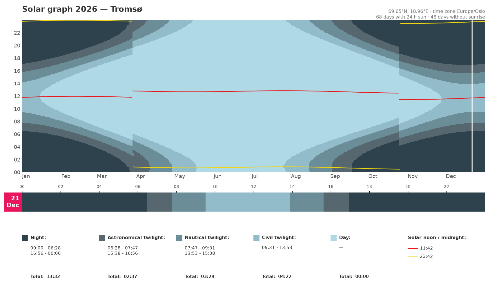
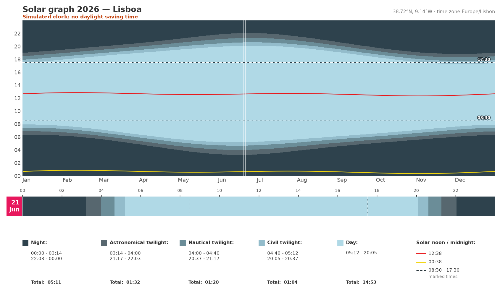
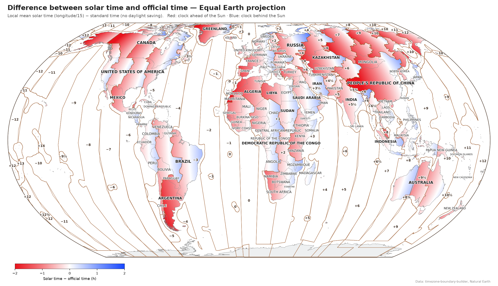
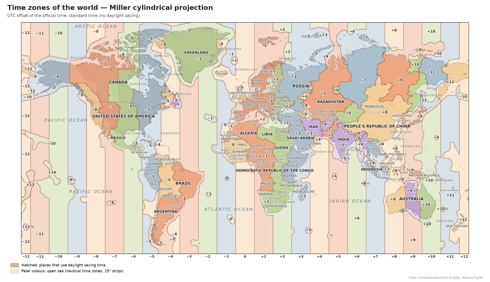
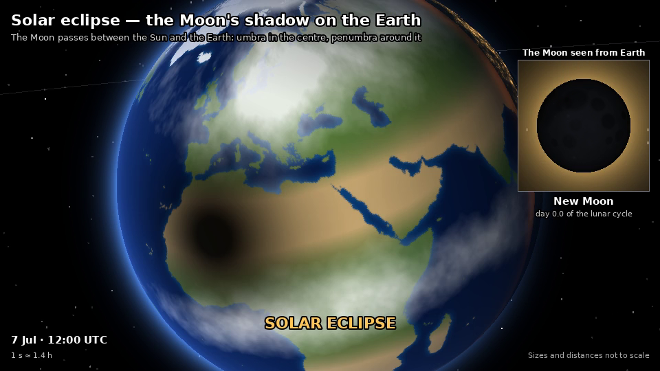

**English** · [Português](README.pt.md)

# sun_graph — graphs, maps and an animation about sunlight

Three independent Python scripts that show how sunlight, clocks and the Sun's
position relate to each other:

| Script | Output |
|---|---|
| [`solar_graph.py`](#solar_graphpy--yearly-sunlight-graph) | Yearly sunlight graph for any place: day, twilights, night, solar noon and midnight |
| [`solar_time_map.py`](#solar_time_mappy--solar-time-vs-official-time) | World map of the difference between solar time and official (clock) time, or a plain time-zone map |
| [`earth_moon_sun.py`](#earth_moon_sunpy--earth--moon--sun-animation) | Animated video: Earth's rotation, the Moon's phases and eclipses, the seasons |

All texts in the images can be produced in English or Portuguese (the map also
in 8 other languages) with `--lang`. By default the system language is used,
falling back to English.

## Installation

Python 3.9 or newer. Install the packages for the script you want to run:

```bash
# solar_graph.py
pip install numpy matplotlib geopy timezonefinder tzdata

# solar_time_map.py
pip install numpy scipy matplotlib cartopy geopandas rasterio shapely tzdata

# earth_moon_sun.py
pip install numpy pillow imageio imageio-ffmpeg
```

`tzdata` is only needed on Windows (Linux and macOS already ship the time-zone
database). Data such as time-zone boundaries and coastlines is downloaded on
the first run and cached in `~/.cache/<script name>`.

---

## `solar_graph.py` — yearly sunlight graph



For every day of a year, in local clock time (daylight saving included), the
graph shows:

- day, civil, nautical and astronomical twilight, and night;
- solar noon (red line) and solar midnight (yellow line);
- a strip for one chosen day, with the start and end of each phase and its total length;
- how many days have 24-hour sun or no sunrise at all.

The Sun's elevation is computed minute by minute with the NOAA algorithms
(accuracy about one minute) instead of sunrise/sunset formulas, so polar
latitudes (midnight sun, polar night) work as well as anywhere else. The jumps
in the lines are the clock changes for daylight saving time.

```bash
python solar_graph.py "Oslo, Norway"
python solar_graph.py "Reykjavik, Iceland" --year 2026 --day 10-25
python solar_graph.py "Lisboa, Portugal" --lang pt --output lisboa.png
python solar_graph.py --lat 69.65 --lon 18.96 --name Tromsø --tz Europe/Oslo --day 12-21
```

### Comparing clocks



Three options help to see how a clock fits the daylight:

- `--mark HH:MM` draws a dashed line at that time, on the yearly graph and on
  the day strip. Repeat it for more lines, e.g. working hours from 08:30 to
  17:30: `--mark 08:30 --mark 17:30`.
- `--dst off` simulates the place **without** daylight saving time (standard
  time all year). `--dst on` does the opposite for a place that has none: it
  adds seasonal daylight saving (+1 h), with the European rule in the northern
  hemisphere (last Sunday of March to last Sunday of October) and, in the
  southern hemisphere, from the first Sunday of October to the first Sunday of
  April.
- `--shift ±H` moves the standard time, e.g. `--shift +1` or `--shift -1`
  (half hours work too: `--shift 0.5`).

A simulated clock is noted in red under the title, and all times in the graph
and the legend follow it.

```bash
python solar_graph.py "Lisboa, Portugal" --mark 08:30 --mark 17:30 --dst off
python solar_graph.py "Madrid, Spain" --shift -1 --mark 09:00 --mark 18:00
python solar_graph.py "Brisbane, Australia" --dst on
```

| Option | Meaning |
|---|---|
| `place` | City and country, looked up on OpenStreetMap (needs internet) |
| `--lat`, `--lon` | Coordinates instead of a place name (no lookup) |
| `--name` | Name shown in the title |
| `--tz` | IANA time zone, e.g. `Europe/Lisbon` (default: found from the coordinates) |
| `--year` | Year to draw (default: current year) |
| `--day MM-DD` | Day shown in detail (default: today) |
| `--mark HH:MM`, `-m` | Dashed line at that time; repeat for more lines |
| `--dst` | `legal` (default: the zone's rules), `off` (no daylight saving), `on` (simulated daylight saving where there is none) |
| `--shift HOURS` | Move the standard time, e.g. `+1` or `-1` |
| `--lang` | `en` or `pt` |
| `--output`, `-o` | Image file (`.png`, `.pdf`, `.svg`); without it a window opens |
| `--show` | Also open a window when saving |

---

## `solar_time_map.py` — solar time vs official time



The colour of each point is

    difference = local mean solar time − official time = longitude / 15 − UTC offset   (hours)

- **red**: the clock is *ahead* of the Sun (the Sun reaches its highest point after 12:00);
- **blue**: the clock is *behind* the Sun;
- **white**: official time is close to solar time.

The colour changes smoothly with longitude inside each country or time zone.
Brown lines are the limits between UTC offsets, and the numbers are the offsets
themselves. Over the sea, each time zone is extended a little from its coast
(`--sea-margin`, 1.5° by default), so small islands such as the Azores (−1),
Iceland (0), Kiribati (+14) or the Chatham Islands (+12¾) get their own line
and label. Nearby islands with the same offset are joined into one outline
(`--island-join`), as for Hawaii, French Polynesia or Chile's Pacific islands.
Beyond that, the open ocean uses the nautical time zones (15° strips).

By default the map uses standard time (no daylight saving); `--date` shows the
legal time in force on a given day instead.

```bash
python solar_time_map.py                                   # Equal Earth, system language
python solar_time_map.py --projection robinson --lang pt
python solar_time_map.py -p mercator --date 2026-07-01      # summer time in force
python solar_time_map.py -p miller --output miller.png --no-names
```

### Plain time-zone map



`--mode zones` draws a classic time-zone map instead: one pastel colour per
UTC offset (half and quarter hours have colours of their own), paler colours
over the open sea, and the places that use daylight saving time hatched. It
also names the oceans and the main seas and bays, and, on cylindrical
projections (`miller`, `mercator`), writes the offset of each 15° strip under
the map. With
`--date` the map shows the offsets in force on that day, and the hatching
marks where daylight saving time is in force. All other options work as
above (`--limit` only applies to the solar map).

```bash
python solar_time_map.py --mode zones -p miller             # time_zones_map.png
python solar_time_map.py --mode zones --date 2026-07-01 --lang pt
```

| Option | Meaning |
|---|---|
| `--mode`, `-m` | `solar` (default: solar time − official time) or `zones` (time-zone map) |
| `--projection`, `-p` | `equal-earth` (default), `robinson`, `miller`, `mercator` |
| `--lang`, `-l` | `en`, `pt`, `es`, `fr`, `de`, `it`, `ru`, `zh`, `ja`, `ar` (`--list-langs` lists them) |
| `--date YYYY-MM-DD` | Use the legal time of that day (daylight saving included) |
| `--limit` | Difference in hours shown with the strongest colour (default 2; solar map only) |
| `--sea-margin` | How far (degrees) each time zone extends into the sea (default 1.5) |
| `--island-join` | Joins islands with the same offset up to about twice this many degrees apart (default 4; 0 = an outline around every island) |
| `--res` | Grid resolution in degrees (default 0.1) |
| `--simplify` | Polygon simplification tolerance in degrees (default 0.02) |
| `--no-names` | Hide country names |
| `--output`, `-o` | Output file (default `solar_time_map.png`, or `time_zones_map.png` with `--mode zones`) |
| `--show` | Also open a window |
| `--cache` | Folder for the downloaded data |

Chinese and Japanese need a CJK font (Windows and macOS already have one).
Arabic with matplotlib older than 3.11 also needs
`pip install arabic-reshaper python-bidi`.

---

## `earth_moon_sun.py` — Earth · Moon · Sun animation



An MP4 video in three acts, joined by smooth camera moves:

1. **Earth's rotation over 24 hours** at the June solstice: the day/night line,
   the 23.4° axial tilt, polar day and night, city lights on the night side, the
   point where the Sun is overhead, and a reference city with its Sun elevation
   through the day.
2. **The Moon over one synodic month** (29.5 days): its orbit and phases as
   seen from the Earth (mirrored for the southern hemisphere), a lunar eclipse
   at full moon and a solar eclipse at new moon. Then: why isn't there an
   eclipse every month? The tilted lunar orbit and the line of nodes.
3. **One year around the Sun** on an elliptical orbit: the axis keeps its
   direction in space and produces the seasons; perihelion and aphelion show
   that the distance to the Sun is not the cause.

Everything is drawn by a small ray tracer written with numpy, with real
continents and city lights from Natural Earth. Sizes and distances are **not
to scale**: at real scale the Moon and the Sun would be too far away to see.

```bash
python earth_moon_sun.py                                    # earth_moon_sun.mp4, 960x540
python earth_moon_sun.py --step 10 --output preview.mp4     # quick preview
python earth_moon_sun.py --scenes 2 --lang en               # only the Moon act
python earth_moon_sun.py --width 1920 --height 1080 --output hd.mp4
python earth_moon_sun.py --city "São Paulo" --lang pt       # southern view of the Moon
python earth_moon_sun.py --city "-8.84,13.23,Luanda"
```

| Option | Meaning |
|---|---|
| `--output`, `-o` | Video file (default `earth_moon_sun.mp4`) |
| `--width`, `--height`, `--fps` | Video size and frame rate (default 960×540, 30 fps) |
| `--speed` | Playback speed factor (2 = half the duration) |
| `--scenes` | Acts to include, e.g. `2` or `1,3` (default all) |
| `--step` | Render only every N-th frame, for a quick preview |
| `--city` | Reference city: a known name or `lat,lon,name` (default Lisboa) |
| `--hemisphere` | How the Moon phases are shown: `auto`, `north`, `south` |
| `--lang` | `en` or `pt` |
| `--show` | Show the frames in a window while rendering |

The full video (about 97 s, 2900 frames) takes a while to render, roughly
20 minutes at 960×540 on a desktop PC; use `--step` and `--scenes` while
experimenting.

---

## Data and credits

- Time-zone boundaries: [timezone-boundary-builder](https://github.com/evansiroky/timezone-boundary-builder) (Evan Siroky), ODbL licence.
- Coastlines, countries and populated places: [Natural Earth](https://www.naturalearthdata.com/), public domain.
- Place lookup: [OpenStreetMap](https://www.openstreetmap.org/) Nominatim, through `geopy`.
- Sun position: NOAA solar calculation algorithms.

The downloaded data keeps its own licence: images made with the time-zone
data should credit timezone-boundary-builder and the OpenStreetMap
contributors (ODbL).

## Licence

The code is released under the [MIT licence](LICENSE).
