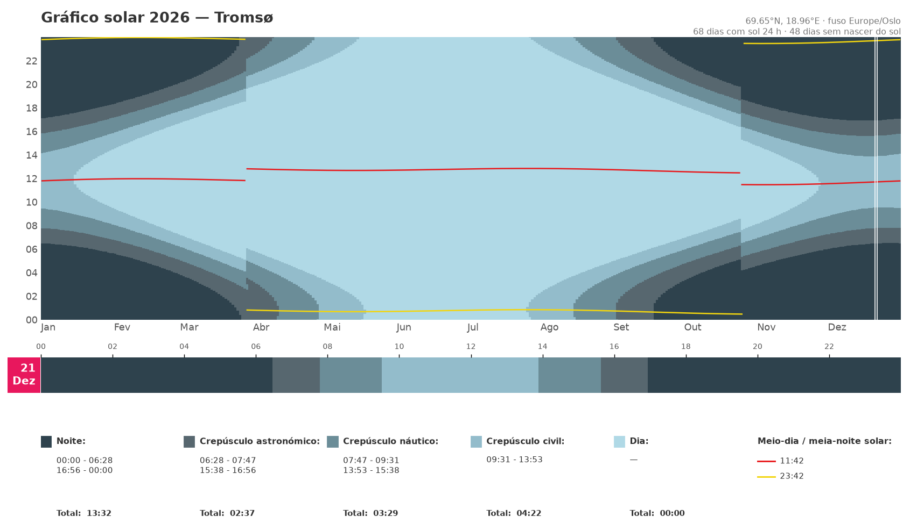
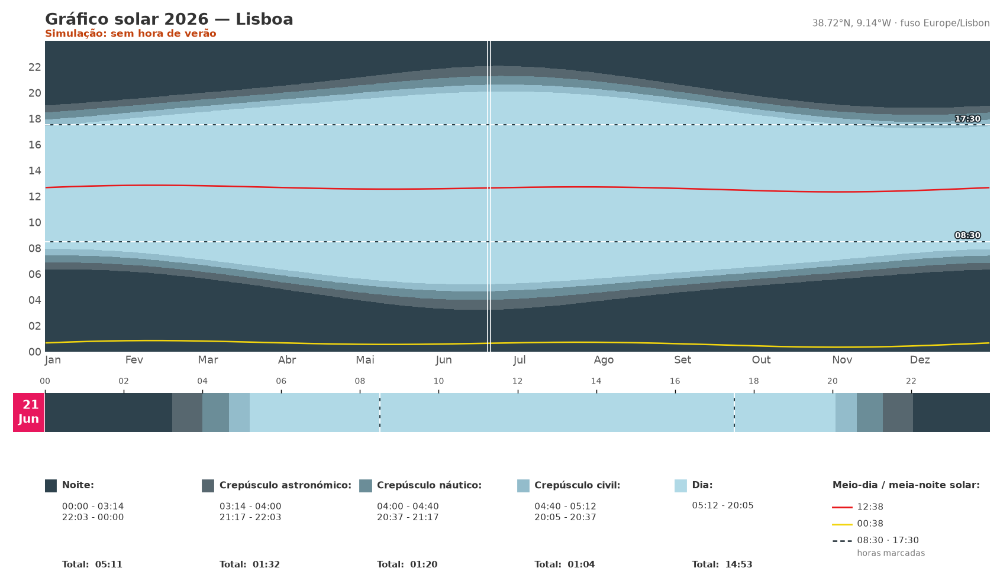
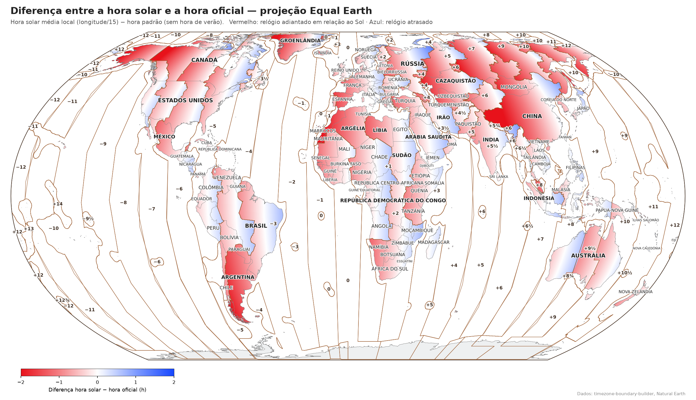
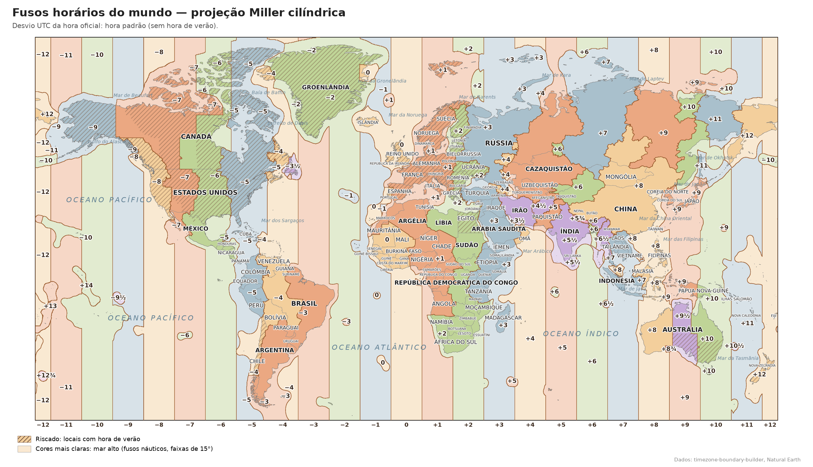
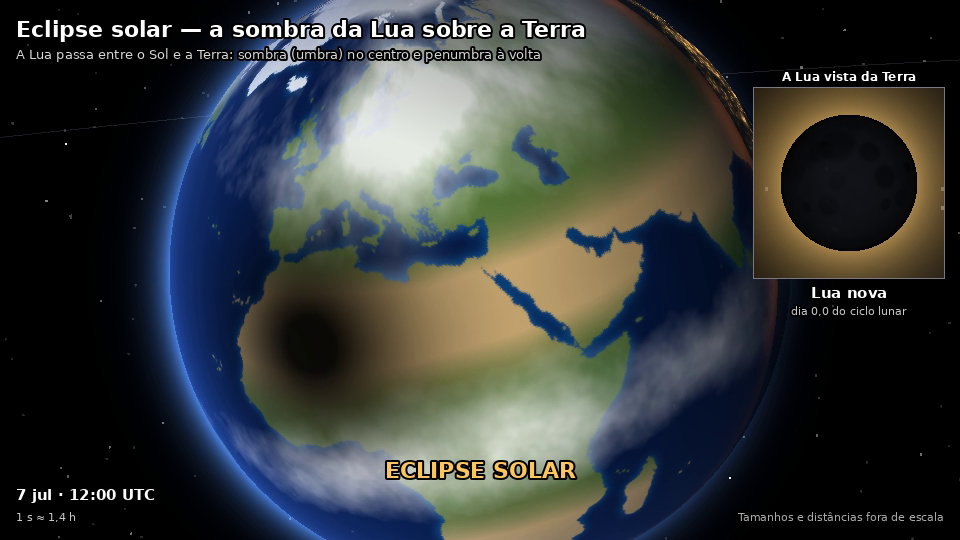

[English](README.md) · **Português**

# sun_graph — gráficos, mapas e uma animação sobre a luz do Sol

Três scripts Python independentes que mostram como se relacionam a luz do Sol,
os relógios e a posição do Sol:

| Script | Resultado |
|---|---|
| [`solar_graph.py`](#solar_graphpy--gráfico-anual-de-luz-solar) | Gráfico anual de luz solar de qualquer local: dia, crepúsculos, noite, meio-dia e meia-noite solares |
| [`solar_time_map.py`](#solar_time_mappy--hora-solar-vs-hora-oficial) | Mapa-múndi da diferença entre a hora solar e a hora oficial (a do relógio), ou dos fusos horários |
| [`earth_moon_sun.py`](#earth_moon_sunpy--animação-terra--lua--sol) | Vídeo animado: rotação da Terra, fases e eclipses da Lua, estações do ano |

Todos os textos das imagens podem sair em português ou inglês (o mapa também
noutros 8 idiomas) com `--lang`. Por omissão é usado o idioma do sistema e,
se não for suportado, o inglês.

O código, os comentários e as opções da linha de comandos estão em inglês.

## Instalação

Python 3.9 ou mais recente. Instale os pacotes do script que quer usar:

```bash
# solar_graph.py
pip install numpy matplotlib geopy timezonefinder tzdata

# solar_time_map.py
pip install numpy scipy matplotlib cartopy geopandas rasterio shapely tzdata

# earth_moon_sun.py
pip install numpy pillow imageio imageio-ffmpeg
```

O `tzdata` só é preciso no Windows (Linux e macOS já trazem a base de dados de
fusos horários). Os dados, como os limites dos fusos e as linhas de costa, são
descarregados na primeira execução e guardados em `~/.cache/<nome do script>`.

---

## `solar_graph.py` — gráfico anual de luz solar



Para cada dia de um ano, na hora do relógio local (com hora de verão), o
gráfico mostra:

- dia, crepúsculo civil, náutico e astronómico, e noite;
- meio-dia solar (linha vermelha) e meia-noite solar (linha amarela);
- uma faixa de um dia escolhido, com o início e o fim de cada fase e a sua duração total;
- quantos dias têm sol 24 horas ou não têm nascer do sol.

A elevação do Sol é calculada minuto a minuto com os algoritmos da NOAA
(precisão de cerca de um minuto), em vez de fórmulas de nascer e pôr do sol.
Por isso funciona tão bem nas latitudes polares (sol da meia-noite, noite
polar) como em qualquer outro lado. Os saltos nas linhas são as mudanças da
hora de verão.

```bash
python solar_graph.py "Lisboa, Portugal" --lang pt
python solar_graph.py "Reykjavik, Islândia" --year 2026 --day 10-25 --lang pt
python solar_graph.py "Porto, Portugal" --lang pt --output porto.png
python solar_graph.py --lat 69.65 --lon 18.96 --name Tromsø --tz Europe/Oslo --day 12-21
```

### Comparar horários



Três opções ajudam a ver como um horário se ajusta à luz do dia:

- `--mark HH:MM` desenha uma linha tracejada a essa hora, no gráfico anual e
  na faixa do dia. Repita-a para mais linhas, p. ex. o horário de trabalho das
  08:30 às 17:30: `--mark 08:30 --mark 17:30`.
- `--dst off` simula o local **sem** hora de verão (hora padrão todo o ano).
  `--dst on` faz o inverso num local que não a tem: acrescenta uma hora de
  verão sazonal (+1 h), com a regra europeia no hemisfério norte (último
  domingo de março ao último domingo de outubro) e, no hemisfério sul, do
  primeiro domingo de outubro ao primeiro domingo de abril.
- `--shift ±H` muda a hora padrão, p. ex. `--shift +1` ou `--shift -1`
  (também aceita meias horas: `--shift 0.5`).

Quando o horário é simulado, isso é indicado a vermelho por baixo do título, e
todas as horas do gráfico e da legenda seguem esse horário.

```bash
python solar_graph.py "Lisboa, Portugal" --lang pt --mark 08:30 --mark 17:30 --dst off
python solar_graph.py "Madrid, Espanha" --lang pt --shift -1 --mark 09:00 --mark 18:00
python solar_graph.py "Brisbane, Austrália" --lang pt --dst on
```

| Opção | Significado |
|---|---|
| `place` | Cidade e país, procurados no OpenStreetMap (precisa de internet) |
| `--lat`, `--lon` | Coordenadas em vez do nome do local (sem pesquisa) |
| `--name` | Nome a mostrar no título |
| `--tz` | Fuso IANA, p. ex. `Europe/Lisbon` (por omissão: obtido a partir das coordenadas) |
| `--year` | Ano a desenhar (por omissão: o atual) |
| `--day MM-DD` | Dia mostrado em detalhe (por omissão: hoje) |
| `--mark HH:MM`, `-m` | Linha tracejada a essa hora; repita para mais linhas |
| `--dst` | `legal` (por omissão: as regras do fuso), `off` (sem hora de verão), `on` (hora de verão simulada onde não existe) |
| `--shift HORAS` | Muda a hora padrão, p. ex. `+1` ou `-1` |
| `--lang` | `en` ou `pt` |
| `--output`, `-o` | Ficheiro de imagem (`.png`, `.pdf`, `.svg`); sem esta opção abre uma janela |
| `--show` | Abre também uma janela quando guarda o ficheiro |

---

## `solar_time_map.py` — hora solar vs hora oficial



A cor de cada ponto é

    diferença = hora solar média local − hora oficial = longitude / 15 − desvio UTC   (horas)

- **vermelho**: o relógio está *adiantado* em relação ao Sol (o Sol atinge o ponto mais alto depois das 12:00);
- **azul**: o relógio está *atrasado* em relação ao Sol;
- **branco**: a hora oficial está próxima da hora solar.

A cor varia de forma contínua com a longitude dentro de cada país ou fuso.
As linhas castanhas são os limites entre desvios UTC e os números são os
próprios desvios. No mar, cada fuso é prolongado um pouco a partir da costa
(`--sea-margin`, 1,5° por omissão), para que ilhas pequenas como os Açores
(−1), a Islândia (0), Kiribati (+14) ou as ilhas Chatham (+12¾) tenham linha e
rótulo próprios. As ilhas próximas com o mesmo desvio ficam dentro de uma só
linha (`--island-join`), como o Havai, a Polinésia Francesa ou as ilhas do
Chile no Pacífico. Para lá disso, o mar alto usa os fusos náuticos (faixas de 15°).

Por omissão o mapa usa a hora padrão (sem hora de verão); `--date` mostra a
hora legal em vigor num dado dia.

```bash
python solar_time_map.py --lang pt                          # Equal Earth
python solar_time_map.py --projection robinson --lang pt
python solar_time_map.py -p mercator --date 2026-07-01 --lang pt   # com hora de verão
python solar_time_map.py -p miller --output miller.png --no-names
```

### Mapa dos fusos horários



`--mode zones` desenha antes um mapa clássico dos fusos horários: uma cor
pastel por desvio UTC (as meias horas e os quartos de hora têm cores
próprias), cores mais claras no mar alto e, riscados, os locais com hora de
verão. Mostra também os nomes dos oceanos e dos principais mares e baías e, nas
projeções cilíndricas (`miller`, `mercator`), o desvio de cada faixa de 15° por
baixo do mapa. Com `--date`, o mapa mostra os desvios em vigor nesse dia e o riscado
marca onde a hora de verão está em vigor. As outras opções funcionam como
acima (`--limit` só se aplica ao mapa da hora solar).

```bash
python solar_time_map.py --mode zones -p miller --lang pt   # time_zones_map.png
python solar_time_map.py --mode zones --date 2026-07-01 --lang pt
```

| Opção | Significado |
|---|---|
| `--mode`, `-m` | `solar` (por omissão: hora solar − hora oficial) ou `zones` (mapa dos fusos) |
| `--projection`, `-p` | `equal-earth` (por omissão), `robinson`, `miller`, `mercator` |
| `--lang`, `-l` | `en`, `pt`, `es`, `fr`, `de`, `it`, `ru`, `zh`, `ja`, `ar` (`--list-langs` mostra a lista) |
| `--date AAAA-MM-DD` | Usa a hora legal desse dia (com hora de verão) |
| `--limit` | Diferença em horas mostrada com a cor mais intensa (por omissão 2; só no mapa da hora solar) |
| `--sea-margin` | Quanto (em graus) cada fuso se prolonga para o mar (por omissão 1,5) |
| `--island-join` | Junta ilhas com o mesmo desvio que distem até cerca do dobro destes graus (por omissão 4; 0 = uma linha à volta de cada ilha) |
| `--res` | Resolução da grelha em graus (por omissão 0,1) |
| `--simplify` | Tolerância de simplificação dos polígonos em graus (por omissão 0,02) |
| `--no-names` | Esconde os nomes dos países |
| `--output`, `-o` | Ficheiro de saída (por omissão `solar_time_map.png`, ou `time_zones_map.png` com `--mode zones`) |
| `--show` | Abre também uma janela |
| `--cache` | Pasta para os dados descarregados |

Chinês e japonês precisam de uma fonte CJK (o Windows e o macOS já têm uma).
Árabe com matplotlib anterior à 3.11 precisa também de
`pip install arabic-reshaper python-bidi`.

---

## `earth_moon_sun.py` — animação Terra · Lua · Sol



Um vídeo MP4 em três atos, ligados por movimentos de câmara suaves:

1. **Rotação da Terra em 24 horas** no solstício de junho: a linha dia/noite,
   a inclinação do eixo de 23,4°, o dia e a noite polares, as luzes das cidades
   no lado noturno, o ponto onde o Sol está a pique e uma cidade de referência
   com a elevação do Sol ao longo do dia.
2. **A Lua durante um mês sinódico** (29,5 dias): a órbita e as fases vistas da
   Terra (invertidas no hemisfério sul), um eclipse lunar na lua cheia e um
   eclipse solar na lua nova. Depois: porque não há um eclipse todos os meses?
   A órbita inclinada da Lua e a linha dos nodos.
3. **Um ano à volta do Sol** numa órbita elíptica: o eixo mantém a direção no
   espaço e provoca as estações; o periélio e o afélio mostram que a distância
   ao Sol não é a causa.

Tudo é desenhado por um pequeno ray tracer em numpy, com continentes e luzes
de cidades reais (Natural Earth). Os tamanhos e as distâncias **não estão à
escala**: à escala real, a Lua e o Sol ficariam longe demais para se verem.

```bash
python earth_moon_sun.py --lang pt                           # earth_moon_sun.mp4, 960x540
python earth_moon_sun.py --step 10 --output preview.mp4      # pré-visualização rápida
python earth_moon_sun.py --scenes 2 --lang pt                # só o ato da Lua
python earth_moon_sun.py --width 1920 --height 1080 --output hd.mp4
python earth_moon_sun.py --city Porto --lang pt
python earth_moon_sun.py --city "São Paulo" --lang pt        # a Lua vista do hemisfério sul
```

| Opção | Significado |
|---|---|
| `--output`, `-o` | Ficheiro de vídeo (por omissão `earth_moon_sun.mp4`) |
| `--width`, `--height`, `--fps` | Tamanho e cadência do vídeo (por omissão 960×540, 30 fps) |
| `--speed` | Fator de velocidade (2 = metade da duração) |
| `--scenes` | Atos a incluir, p. ex. `2` ou `1,3` (por omissão todos) |
| `--step` | Renderiza só uma em cada N imagens, para pré-visualizar |
| `--city` | Cidade de referência: um nome conhecido ou `lat,lon,nome` (por omissão Lisboa) |
| `--hemisphere` | Como são mostradas as fases da Lua: `auto`, `north`, `south` |
| `--lang` | `en` ou `pt` |
| `--show` | Mostra as imagens numa janela durante a renderização |

O vídeo completo (cerca de 97 s, 2900 imagens) demora a renderizar, cerca de
20 minutos a 960×540 num PC de secretária; use `--step` e `--scenes` enquanto
experimenta.

---

## Dados e créditos

- Limites dos fusos horários: [timezone-boundary-builder](https://github.com/evansiroky/timezone-boundary-builder) (Evan Siroky), licença ODbL.
- Linhas de costa, países e localidades: [Natural Earth](https://www.naturalearthdata.com/), domínio público.
- Pesquisa de locais: Nominatim do [OpenStreetMap](https://www.openstreetmap.org/), através do `geopy`.
- Posição do Sol: algoritmos de cálculo solar da NOAA.

Os dados descarregados mantêm a sua própria licença: as imagens feitas com os
dados dos fusos devem creditar o timezone-boundary-builder e os contribuidores
do OpenStreetMap (ODbL).

## Licença

O código é distribuído sob a [licença MIT](LICENSE).
